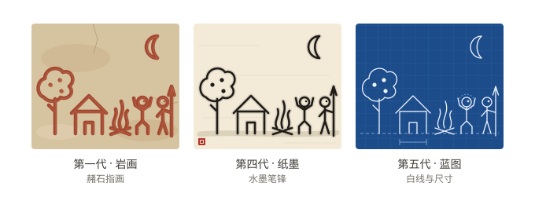

# 《丹青纪》构想 · Drawn Ages

> 第一版构想，已被[《纸上文明》构想](纸上文明_构想.md)取代：参考图定下了神的视角、三支笔、八个时代和符号识别方案。本文只留作素材。

2026-11-19 · 工作名（备选：岩上人家、画个文明）

## 一、一句话

**你画的东西会活过来，族人照着你画的样子过日子。文明每往前走一代，世界上你画过的所有东西都换一种画法重画一遍。**

你从石壁上的赭红火柴人画起，经过陶纹、青铜、水墨，最后在一张蓝图上画火箭，送一个火柴人上月亮。它举着双手，姿势和你画的第一个人一样。

取名「丹青」，是因为开头是丹（赭红岩画），结尾是青（蓝图）。

## 二、三条核心

1. **画了就活。** 画完点一下（点睛），火柴人眨眨眼站起来，火烧起来，树开始结果。整个游戏只有一支笔：不点菜单、不派工、不读说明文字。
2. **你画的是「头一个」。** 你画一把矛，族人照它的样子做出十几把；重画一把更长的，往后就照新的做。画是发明，不是劳动。形状说了算：矛越长够得越远，尖越锐伤得越重；屋顶没封口会漏雨；没画门，族人只好自己凿一个。
3. **画风就是时代。** 每进一代，所有笔画按新画法重画：赭石指画 → 彩陶纹 → 青铜刻线 → 水墨 → 蓝图白线。一局下来，五代连成一幅长卷。

## 三、头一分钟

> 一面石壁，火光在晃。提示只有一个图形：火柴人。
>
> 你用手指画了一个。头画大了，一条腿比另一条长。点一下他的脑袋，那一点成了眼睛。他眨眨眼，从壁上走下来，一瘸一拐（腿本来就不一样长），抬头看月亮。
>
> 他头顶冒出一个发抖的小图：冷。你在他脚边画几道往上蹿的线，还没画完，他就凑过来嘀咕「火？」。点一下，火着了。他蹲在火边，影子投在石壁上。
>
> 天亮了，他饿。你在远处画一棵树，在树冠里点三个圈，树上就结了三个果。他摘来吃了，靠着树干睡着，头顶浮起一个小小的古字：休。
>
> 你又画了一个人。两人碰面，一前一后走回火边，头顶浮起「从」。第二天夜里，火边多了一个小人，长得像他们俩各一半。
>
> 黑暗里亮起两对绿眼睛。你赶紧画一根长矛，尖头画得很锐。他捡起矛，挡在火和孩子前面。

## 四、笔怎么用

### 四个动作

| 动作 | 做什么 |
|---|---|
| 画 | 直接画在世界上，先是淡淡的草稿，可以接着添笔 |
| 点 | 在草稿上点一下，即点睛，它就成真。人和兽身上点的那一下就是眼睛 |
| 涂抹 | 在自己画的东西上来回涂，抹掉，退还一半颜料 |
| 双指 | 拖动、缩放，凑近了画细节 |

画在已有的东西上，就是改它：在树冠里画圈就结果，在屋上补门、补烟囱，在木棍头上加个尖就成了矛。

### 族人猜你画的是什么

识别不做成「判对错」，而是族人围过来猜：

- 每画一笔，附近族人头顶冒出猜测泡泡（小图标），最像的那个最大。画到他们猜对，点睛即可；猜错了，就点你要的那个泡泡。
- **按位置猜**：贴着地面的封闭形状多半是屋；画在水上的是船；跨过河的是桥；画在人手边的是他拿着的东西；画在天上的是日月、鸟、云。位置先把候选缩到几样，认起来准得多。
- **认不出来也不白画**：族人把它当图腾供起来，加一点士气。
- 每代只认十来样。玩家画过、点认过的样子会记成「这位玩家的画法」，下次认得更准。
- 泡泡里的图标一代比一代简，越往后越像字。泡泡本身就在演文字的来历。

### 形状说了算

| 画的 | 量什么 | 管什么 |
|---|---|---|
| 人 | 腿长、头大小、臂长、胳膊几条 | 走多快、学多快、力气、一次拿几样 |
| 矛 / 戈 | 长度、尖角 | 够多远、伤多重 |
| 屋 | 大小、屋顶封没封口、有没有门 | 住几人、漏不漏雨、进不进得去 |
| 火 | 火苗高低 | 照多远、耗多少柴 |
| 树 | 树冠大小、画了几个果 | 出多少木头、结多少果 |
| 舟 | 船身封口、弧度、长度 | 浮不浮、载几人 |
| 轮 | 圆不圆 | 车跑得快，还是颠 |
| 桥 | 跨度够不够、有没有墩 | 过不过得去、承多重 |
| 墙 | 高度、有没有缺口 | 挡不挡得住、敌人从哪钻进来 |

数值上下都夹住：画得歪不会废掉，画得好有奖励。怪画有怪用处：三条胳膊的人能多拿一样东西，没画腿的就坐着编筐。

## 五、一局怎么转

**需求 → 画 → 族人认 → 用起来 → 照着做 → 新的需求。**

- **需求泡泡**：族人头顶的图标，有饿、冷、怕、累、病。同一个需求有几种解法：怕狼，可以画火、画矛、画篱笆，也可以在火边画一只狼。你画出来的东西都向着这一族，所以你画的狼会看家。
- **颜料**：每一笔按长度花颜料。族人去石壁刮赭石、从火堆取炭，后几代有陶土、铜绿、墨烟。画得越简越省，这条规则会把你的画一路逼向「字」（见第七节）。
- **照着做**：族人照你的画仿造，要花材料（矛要木头和石头，屋要木头）。人口靠火、屋和余粮自然增长；也可以花一大笔颜料直接画一个人。孩子长得像父母各一半。
- **时间**：有昼夜、四季。落笔时光阴放慢，族人猜的时候停住。夜里有兽，冬天缺粮。
- **玩家不派工**：族人自己挑活干，你只决定世上有什么。

## 六、五个时代

| 代 | 画布与画法 | 新能画的 | 压力 | 收尾大事 |
|---|---|---|---|---|
| 一 · 岩画 | 石壁，赭红指画 | 人 火 树 棚 矛 鹿 鱼 | 夜里的狼，第一个冬天 | **长夜**：冬至夜狼群来，火不能灭 |
| 二 · 彩陶 | 陶面，红黑纹带 | 田 禾 屋 罐 猪 舟 网 | 存粮过冬，春汛 | **洪水**：画堤能挡一时，迟早溃；画渠疏导才行（鲧堵禹疏） |
| 三 · 青铜 | 铜器，绿锈刻线 | 弓 戈 车 墙 鼎 井 | 邻族，旱 | **十日并出**：画弓，射下九个；射下第十个就是永夜 |
| 四 · 纸墨 | 宣纸，水墨 | 桥 船 城 书 水车 | 疫病，大江隔开两岸 | **两岸**：用桥、船、驿路把世界连成一片 |
| 五 · 蓝图 | 蓝图纸，白线标注 | 机器 车 飞机 火箭 | 燃料，发射窗口 | **奔月**：火箭的尖、翼、对称决定飞得稳不稳 |

- 每代 6–10 分钟，一局约 40 分钟，可以中途存档。
- 乐器跟着换：骨笛 → 陶埙 → 编钟 → 古琴 → 电子音，全部用 WebAudio 合成。
- 换代那一刻：镜头拉远，石壁化成陶土，所有笔画按新画法重画一遍。你画的第一个人一直都在，从赭红小人变成墨线小人，最后变成蓝图上的白线小人。

## 七、画着画着，就成了字

这是第二层玩法，从第二代开始出现。

- **会意**：你画的东西在世上凑到一起，族人就给这个组合起一个古字。人靠着树是「休」，屋下养猪是「家」，两棵树是「林」，日月同在天上是「明」，三个人是「众」，人拿着戈是「伐」。每个字是一项小科技（休：树下歇得快；家：有猪的屋里多生孩子；明：夜里不那么怕）。**科技树就是一本字典**，四五十个字，要靠你在世上摆出来。
- **成字**：第三代末字数凑够，就到了仓颉那一夜：天雨粟，鬼夜哭（真下一场小米，夜里有哭声）。从此可以直接**写**字：写「木」就种一棵树，颜料只要画一棵树的五分之一。写的是甲骨文的样子，族人泡泡里会示范。甲骨文本来就像简笔画，所以写字还是在画画。

和《墨灵》的区别：墨灵是笔即刃的动作游戏，字是招式；这里是经营，字是你在世上摆出来的发明。墨灵的点云识字可以直接复用。

## 八、输了怎么办，带走什么

- **湮灭**：族人死光，这一局就结束。你画过的东西留在石壁上，褪成淡淡的岩画。下一局的族人会在壁上发现它们，照着重新学会（这些东西第一次画只要半价）。上一个文明，成了下一个文明的岩画。
- **长卷**：一局的各个时代连成一幅长卷，可以存成图片。
- **器物志**：你画的每样东西一张卡，例如「第一把矛 · 第三天 · 长三尺 · 族人照做十四把 · 猎得野猪九头」。
- **字典**：你凑出来的字，以及你写它们的样子。

## 九、和别的游戏差在哪

- 《涂鸦冒险家》写词变物，画主角的游戏让你画好拿去用。它们都只是「画了拿来用」，没有一群人接着你的画活下去。
- 《涂鸦上帝》是合成表，《孢子》从部落一路走到太空。结构上相像，但这里唯一的动作是画，而且这个文明长什么样，全是你画出来的。

## 十、怎么做

和现有几个项目一个路子：零依赖，Canvas 2D + WebAudio，画面和声音全部由代码生成，手机优先，能装到主屏离线玩。世界是侧视的长条，所以横屏为主；竖屏多露一些天空。

| 部分 | 做法 |
|---|---|
| 笔迹 | 复用墨灵的笔迹采集。每样东西存原始笔画，换代时换渲染器重画 |
| 识别 | 先用规则：按位置筛候选，再看结构特征（闭合、尖角、圆度、横竖比、笔数），加上点云模板（墨灵 `glyph.js` 的 $P 思路）。不够准，再拿 Quick, Draw! 数据集（谷歌公开，CC BY 4.0，5000 万张涂鸦）训一个几百 KB 的小卷积网络，推理代码手写，仍然零依赖 |
| 火柴人骨架 | 找头（闭合的圈）→ 身子（从头往下最长的一笔）→ 四肢（搭在身子上段、下段的笔），肘和膝取中点。找不出骨架，就让整张纸片跳着走。四足兽同理 |
| 族人 | 侧视地面上的小人，按需求打分挑活（采集、打猎、添柴、仿造、歇息），每代十几到几十个 |
| 仿造 | 照原画重画，每份加一点手抖；孩子的骨架取父母的平均 |
| 画风 | 每代一个笔触渲染器：赭石（粗、干、带颗粒）、陶纹、刻线、水墨（复用墨灵）、蓝图（细线加标注）。每件设计画好后缓存成图，不每帧重画 |
| 工具 | `tools/sim.mjs` 按脚本画画、跑族群，用来调颜料和人口数值；`tests/` 放识别样本（模板扰动合成的，加上收集来的真人画）；`tools/shots.mjs` 按真实时钟截图 |

## 十一、第一个可玩版：「第一面岩壁」

只做第一代，一局 8–10 分钟：从春到冬一年，熬过长夜就算过关。

- 场景：四屏宽的山谷，有石壁、河和林子。一天 40 秒（初值）。
- 能画 7 样：人、火、树（树冠里画圈就结果）、棚、矛、鹿、鱼（画在水里）。认不出来的当图腾。
- 系统：颜料，饿、冷、怕三种需求，仿造，生孩子，夜狼，寒冬。
- 4 个会意彩蛋：休、从、林、炎。
- 过关后给长卷和器物志。
- 这一版不做：其他时代、写字、湮灭传承、存档。

这一版要回答四个问题。前三个机器能测，先测；真人试玩作复核点，不卡开发。

| 问题 | 怎么量 | 及格线（初值） |
|---|---|---|
| 认得准吗 | 合成样本，加上收集到的真人画 | 第一猜对 ≥85%，前三猜对 ≥95% |
| 火柴人活得起来吗 | 随手画的火柴人 | ≥80% 认出骨架、走起来，其余纸片跳 |
| 画得多不多 | 模拟和实玩时每局画几次 | 15–30 次，不是 100 次；颜料逼出先画什么、后画什么 |
| 想不想接着画 | 真人试玩 | 看到族人用上你的画，你会想再添点什么 |

## 十二、风险

| 风险 | 对策 |
|---|---|
| 认不准，画了房子说是船 | 按位置筛选；每代只认十来样；族人实时猜，点泡泡就能改；认不出的当图腾；记住玩家自己的画法 |
| 画累了 | 只画头一个，族人照着做；后期写字当快捷 |
| 手机上画不准 | 双指缩放；大小相对族人算；识别放宽 |
| 火柴人画得太怪 | 退回纸片跳；怪有怪的用处 |
| 族人自己就能过，玩家没事干 | 需求泡泡、夜晚和收尾大事逼你画；颜料攒满时提醒 |
| 五代做不完 | 先做第一代。后面每代是一个内容包：十来样新画、一种压力、一件大事、一种画风 |

## 十三、要你拍板的

1. **题材**：走中国画史这条线（岩画 → 蓝图），还是通用的蜡笔儿童画？推荐前者。画风换代是这个游戏最独特的地方，第四代也接得上墨灵的水墨。
2. **终点**：到奔月（现代，首尾呼应），还是停在纸墨成字（古典，范围小一半）？推荐奔月，但等做到第三代再定。
3. **识别**：先用纯规则加模板，不够准再上小模型？推荐分两步，先看规则能做到多准。
